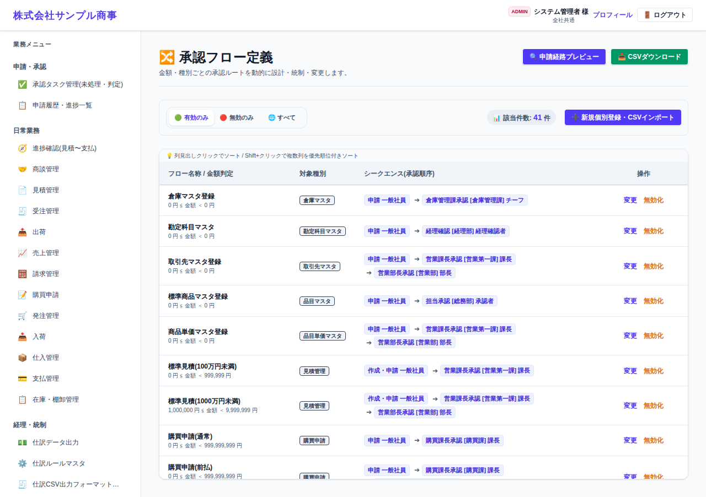
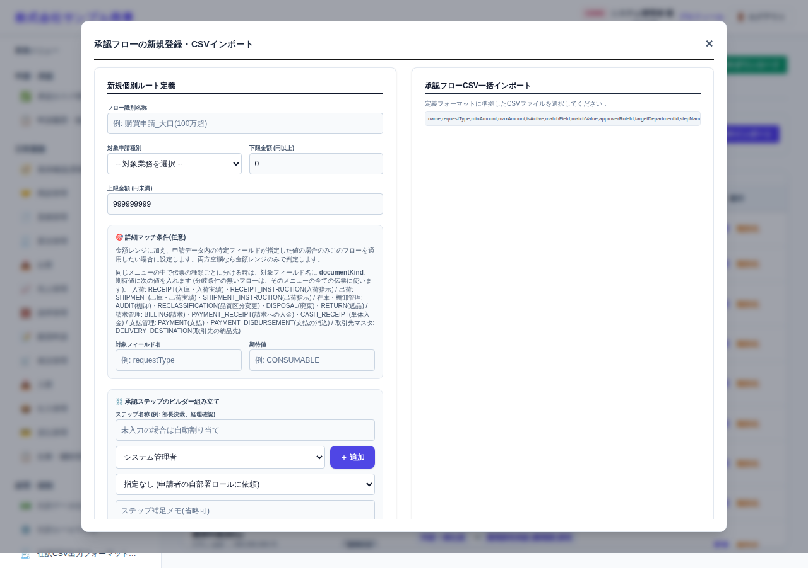
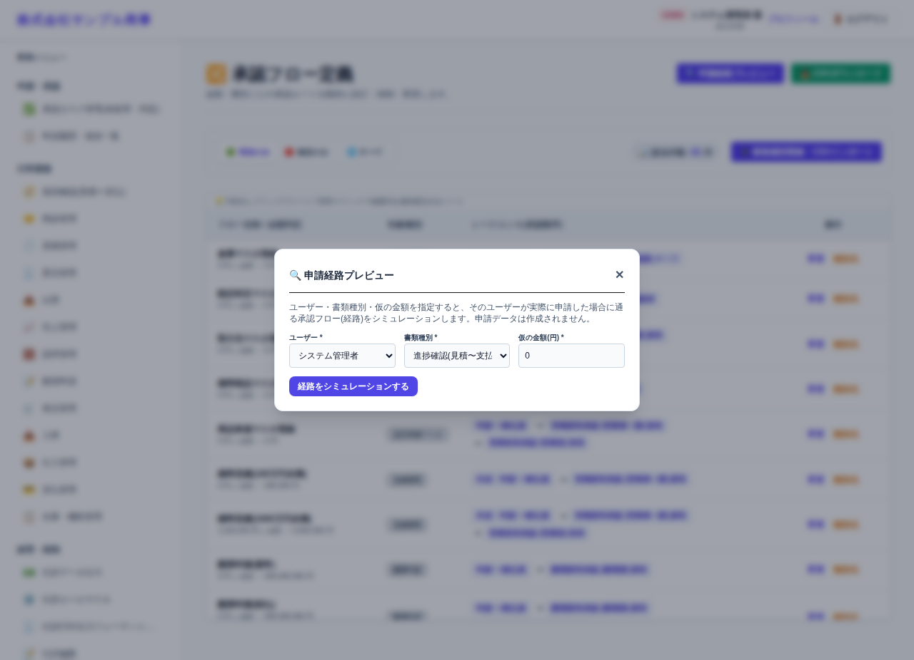

# 承認フロー定義

[マニュアルの一覧](../README.md) > 基本マスタ設定 > 承認フロー定義

申請の種類・金額ごとに、承認の経路(何段で、どのロールが承認するか)を設定します。

- **開き方**: メニューの **基本マスタ設定** > **承認フロー定義**
- **対象**: 管理者
- 一覧・検索・並び替え・CSV・承認の共通の操作は、[共通の操作](../basics/common-operations.md) を参照してください。

## 一覧

1行が1つのフローです。**フロー名称 / 金額判定**・**対象種類**・**シーケンス(承認順序)** が表示されます。

## 登録する

**新規個別登録・CSVインポート** を押します。

| 項目 | 説明 |
|---|---|
| フロー名称・対象(申請の種類) | 例: 見積、受注、購買申請、取引先マスタ登録 |
| 金額の範囲 | この金額の範囲の申請に使います(金額によって経路を変えられます) |
| 条件(任意) | 特定の条件(例: 購買区分が前払)の申請だけに使うフロー |
| 承認の段 | 段ごとに、承認するロール(と部署)を設定します |

- 同じ申請の種類に複数のフローがある場合は、金額の範囲で候補を絞り、条件が一致するフローを優先して使います。
- 承認フローは **メニュー単位** で作ります。申請は、伝票を作るメニューの承認フローを使います。条件の無いフローは、そのメニューの全ての伝票に使います。

  | メニュー | 使う伝票 |
  |---|---|
  | 入荷 | 入庫・入荷実績・入荷指示(倉庫間移動の入庫を含む) |
  | 出荷 | 出庫・出荷実績・出荷指示(倉庫間移動の出庫を含む) |
  | 在庫・棚卸管理 | 棚卸・品質区分の変更・廃棄・返品 |
  | 仕入管理 | 仕入 |
  | 請求管理 | 請求・入金(請求への入金・単体入金) |
  | 支払管理 | 支払・支払の消込 |
  | 取引先マスタ | 取引先・取引先の納品先 |

- 同じメニューの中で、伝票の種類ごとに承認者を変える時は、条件の **対象フィールド名** に `documentKind`、**期待値** に次の値を入れます。
  入荷: `RECEIPT`(入庫・入荷実績)・`RECEIPT_INSTRUCTION`(入荷指示)、出荷: `SHIPMENT`(出庫・出荷実績)・`SHIPMENT_INSTRUCTION`(出荷指示)、
  在庫・棚卸管理: `AUDIT`(棚卸)・`RECLASSIFICATION`(品質区分変更)・`DISPOSAL`(廃棄)・`RETURN`(返品)、
  請求管理: `BILLING`(請求)・`PAYMENT_RECEIPT`(請求への入金)・`CASH_RECEIPT`(単体入金)、
  支払管理: `PAYMENT`(支払)・`PAYMENT_DISBURSEMENT`(支払の消込)、取引先マスタ: `DELIVERY_DESTINATION`(取引先の納品先。取引先そのものの申請には値がありません)。
- 承認を使うかどうか(ON/OFF)は、[会社設定](company-settings.md) の承認機能で、伝票ごとに切り替えます。
- 各段の承認者は、申請者(または申請時に選んだ申請部署)の部署と、設定したロールから決まります。

## 申請経路プレビュー

**申請経路プレビュー** で、ユーザー・申請種別・仮の金額を指定して **経路をシミュレーションする** と、そのユーザーが申請した場合の承認経路を確認できます(申請データは作られません)。組織の変更の後などの確認に使います。
