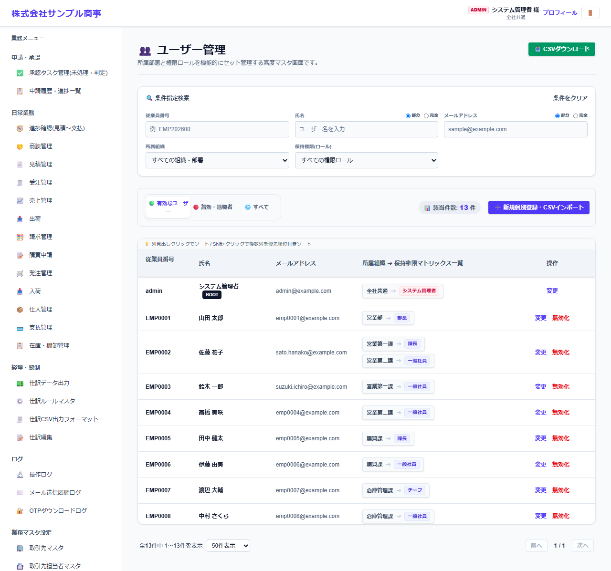
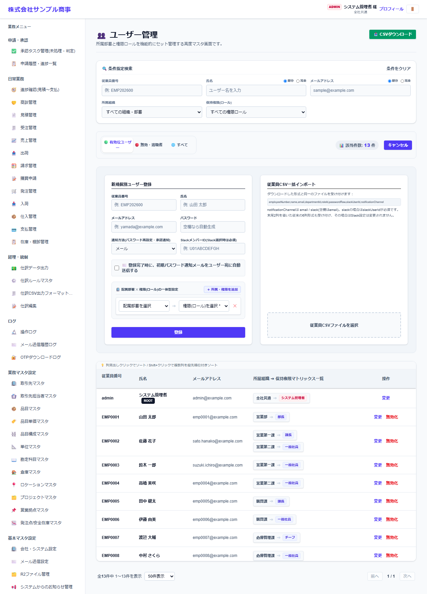

# ユーザー管理

[マニュアルの一覧](../README.md) > 基本マスタ設定 > ユーザー管理

システムを使うユーザーを登録し、所属する部署とロール(権限)を割り当てます。

- **開き方**: メニューの **基本マスタ設定** > **ユーザー管理**
- **対象**: 管理者
- 一覧・検索・並び替え・CSV・承認の共通の操作は、[共通の操作](../basics/common-operations.md) を参照してください。

## 一覧



従業員番号・氏名・メールアドレス・所属組織・ロールで絞り込めます。タブで **有効なユーザー**・**無効・退職者**・**すべて** を切り替えます。

## 登録する

**新規個別登録・CSVインポート** を押します。



| 項目 | 説明 |
|---|---|
| 従業員番号・氏名・メールアドレス | ログインに使います |
| パスワード | 空欄にすると自動で作ります。最初のログインで変更を求められます |
| 通知方法・SlackメンバーID | 承認の通知の受け取り方(本人もプロフィールで変えられます) |
| ログイン時に確認コード(OTP)を使う | ログインの時、パスワードの後に確認コードの入力を求めます。コードは通知方法(メール/Slack)に送り、Slack に送れない場合はメールに送ります。有効にするには、メールアドレスと、会社設定のメール送信(SMTP)の設定が必要です(無い場合は保存できません)。OTP を使うユーザーは、一覧の氏名の横に **OTP** と表示されます |
| 登録完了時に、初期パスワード通知メールをユーザー宛に自動送信する | |
| 配属部署 × 権限(ロール)の一括設定 | **+ 所属・権限を追加** で、部署とロールの組み合わせを複数登録できます(兼務) |

- 退職などで使わなくなったユーザーは **無効化** します。
- 画面ごとの権限は、ロールに対して **画面・権限マスタ** で設定します。

## CSV インポートの列

ダウンロードした CSV と同じ形式を取り込めます。

`employeeNumber,name,email,departmentId,roleId,passwordRaw,slackUserId,notificationChannel,loginOtpEnabled`

- `loginOtpEnabled`(ログイン時の確認コード)は `true` / `false`(空欄は `false`)。`true` にするには、会社設定のメール送信(SMTP)の設定が必要です。
  条件を満たさない行がある場合は、その行の番号を示してエラーになり、1件も取り込みません。
- 末尾の列を省いた形式(`loginOtpEnabled` の無い8列、Slack の列も無い6列)も取り込めます。その場合、省いた列の設定は変わりません。

## 確認コード(OTP)でログインできなくなった場合

- 確認コードの間違いが続いてロックされたユーザーは、パスワードの場合と同じく、他の管理者が **有効** に戻します。
  初期のシステム管理者は無効化されず、一定時間(15分)たてば、またログインできます。
- メールも Slack も届かず確認コードを受け取れない場合は、まずメール送信ログ・会社設定のメール送信を確認してください。
- 管理者がだれもログインできなくなった場合の最後の手段として、Cloudflare の D1 を直接操作して、そのユーザーの確認コードを OFF にできます
  (Cloudflare のアカウントの権限が必要です。操作は記録に残らないため、作業の内容を別に記録してください)。

  ```bash
  # packages/backend で実行する。Staging は --env staging を付ける(本番は付けない)
  npx wrangler d1 execute DB --env staging --remote \
    --command "UPDATE users SET login_otp_enabled = 0 WHERE email = 'admin@example.com'"
  ```

  ログインできたら、ユーザー管理で確認コードの設定を見直してください。
