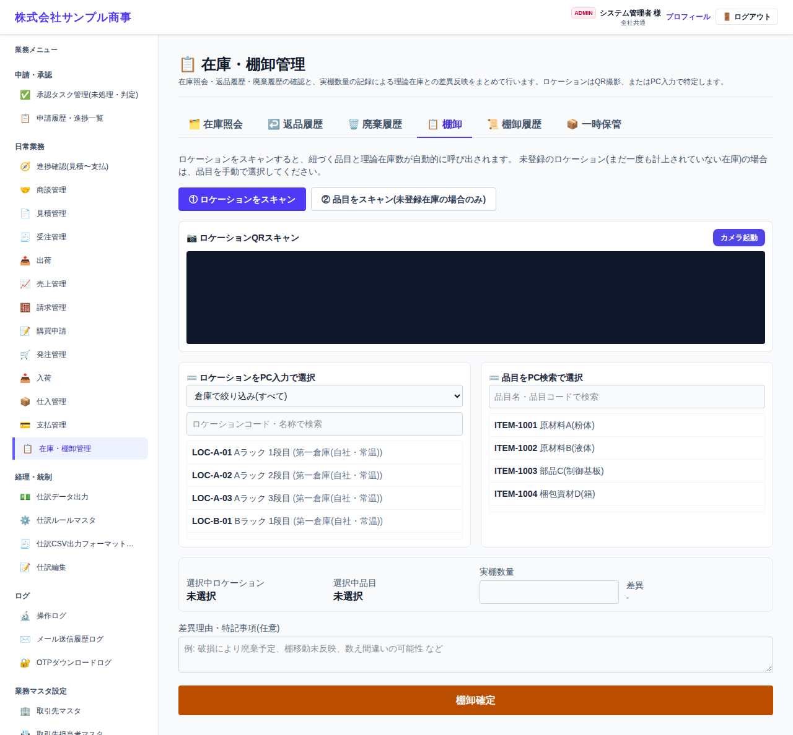
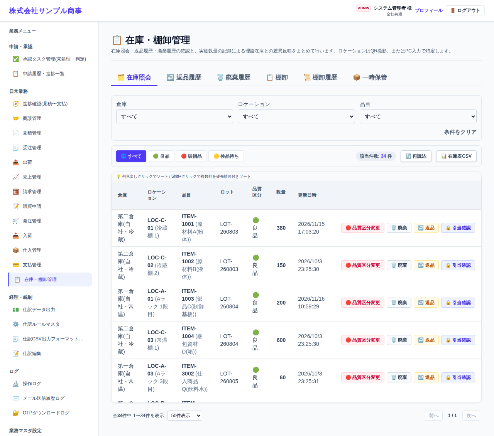
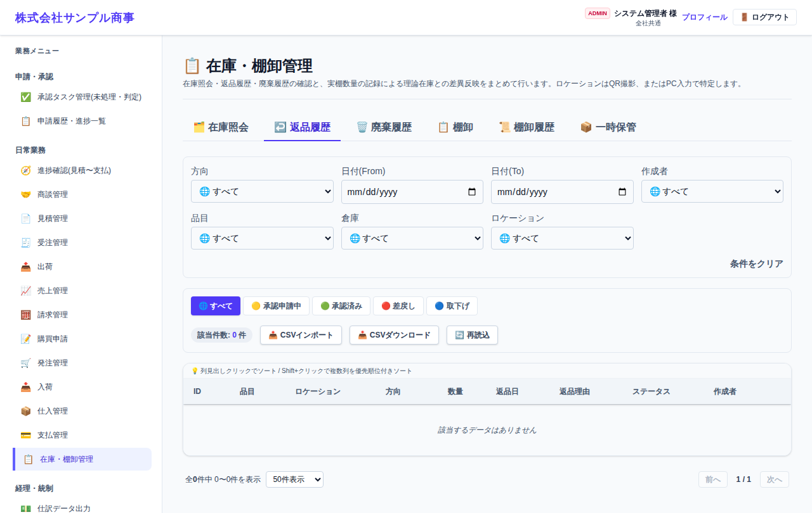
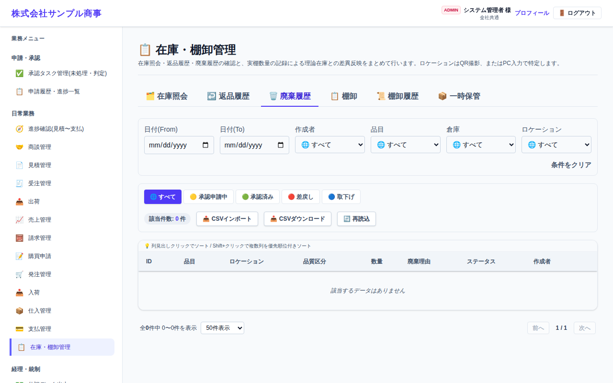
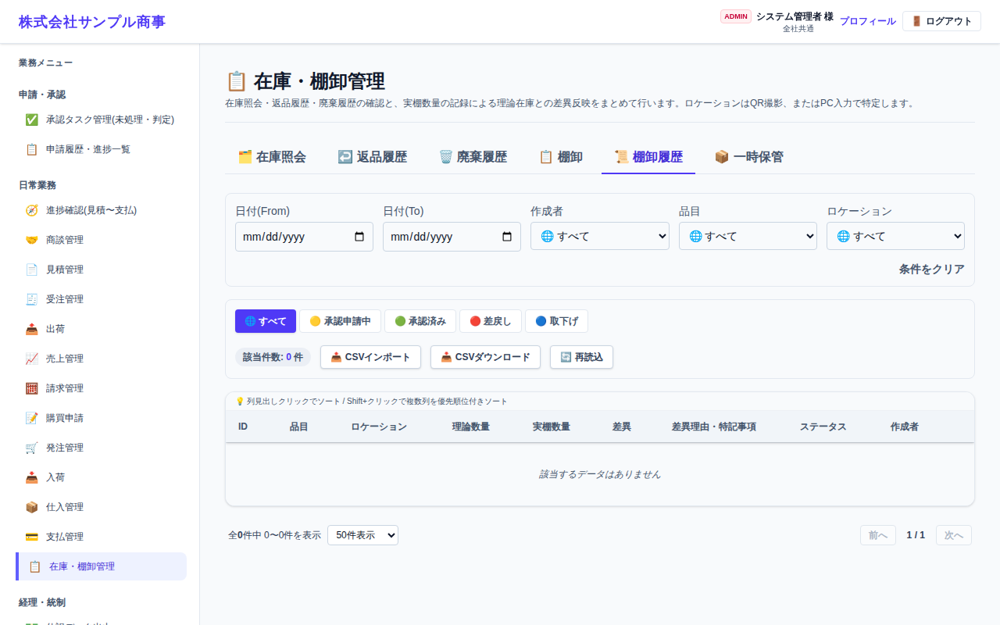

# 在庫・棚卸管理

[マニュアルの一覧](../README.md) > 日常業務 > 在庫・棚卸管理

在庫の照会と、棚卸(実際の数との差の調整)、品質区分の変更・廃棄・返品の記録を確認します。

- **開き方**: メニューの **日常業務** > **在庫・棚卸管理**
- **対象**: 全員
- 一覧・検索・並び替え・CSV・承認の共通の操作は、[共通の操作](../basics/common-operations.md) を参照してください。

画面の上のタブで作業を切り替えます。

## 棚卸

1. **① ロケーションをスキャン** で棚の QR コードを読み取ります(スマートフォンのカメラ、またはパソコンの一覧から選択)。
2. 品目を選ぶと、システム上の在庫数(理論在庫)が表示されます。まだ在庫が無い品目は **② 品目をスキャン** で選びます。
3. 実際に数えた数(**実棚数量**)を入力します。差があれば **差異** が表示されます。
4. 差異の理由(破損・棚移動の誤り・数え間違いの可能性など)を入力して、**棚卸確定** を押します。

## 在庫照会

品目・倉庫・ロケーション・ロット・品質区分(良品・破損品・検品待ち)ごとの在庫数を確認します。
在庫照会の画面から、品質区分の変更・廃棄・返品を登録できます(承認機能を使う場合は申請になります)。

倉庫間移動で出庫して、まだ入庫していない数量は、一覧の下の「🚚 輸送中の在庫」に出ます(移動元・移動先どちらの在庫数にも含みません)。

## 履歴

| 返品履歴 | 廃棄履歴 | 棚卸履歴 |
|---|---|---|
|  |  |  |

- **返品**: 仕入先へ返品(在庫が減る)・得意先から返品(在庫が増える)の両方を記録します。
- **廃棄**: 在庫を最終的に処分します。

## 一時保管

品目マスタに無い物(発注・受注の直接入力の明細、取引先からの預り品など)を、在庫とは別の台帳で管理します。
在庫数・引当・棚卸・在庫評価・仕訳には含めません。タブは、在庫・棚卸管理の権限(閲覧)があるロールに出ます。受入・払出・調整には登録の権限、削除には削除の権限が必要です。

- **受け入れる**: 区分(**自社品** / **預り品**)・品名・規格・数量・単位・倉庫・保管場所・取引先・受入日・払出予定日を入れます。預り品は取引先(預け主)が必須です。
- 発注の詳細の入荷状況にある「品目マスタに無いため対象外」の明細の **一時保管で受入** から開くと、品名・数量・取引先を引き継ぎます。
  発注の入荷済数量には数えません(台帳に発注番号を残します)。
- このタブの **受け入れる** からも、**発注番号から選ぶ** で発注番号(一部でも可)を検索し、発注の直接入力の明細を選べます(品名・数量・取引先を引き継ぎ、台帳に発注番号を残します)。
- **詳細** から、**払い出す**(残りまで)・**数量を調整する**(増やす時は+、減らす時は−。理由が必須)ができます。動きの履歴も詳細で見られます。
  受注の詳細の出荷状況にある **一時保管から払出** から開くと、その受注の明細に紐づけて払い出します。
  詳細の **払い出す** でも、**受注番号から選ぶ** で受注番号を検索し、受注の直接入力の明細に紐づけて払い出せます。
- 一覧のキーワードは、品名・一時保管の番号・発注番号・払い出した受注の番号で探せます。
- 数量が 0 になると **払出済** になります。払出予定日を過ぎた保管中の物は、一覧で赤く出ます。区分・状態・倉庫・キーワードで絞り込み、CSV に出力できます。
- **承認**: [承認フロー](../admin/approval-flows.md) で対象 **一時保管** の承認フローを作ると、受入・払出・調整は1件ごとに承認されてから数量に入ります
  (一覧に **承認待ち** の増減を出します)。承認フローが無ければ、承認なしですぐ確定します。差し戻された動きは数量に入りません。
- 受入が差し戻されて確定した動きが無い一時保管は、詳細から削除できます。
- **在庫へ移す**(自社品だけ): 詳細の **品目マスタに登録して在庫へ移す** で、品目とロケーション(同じ倉庫)・入庫日を選ぶと、残りの数量で入庫を作ります。
  入庫の承認が有効なら入庫の承認を申請し、承認されると **在庫へ移行済** になります(承認待ちの間は払出・調整できません。入庫を取り下げると元に戻ります)。
  品目マスタに無い場合は、先に品目マスタに登録します。預り品は自社の在庫にしないため、払出で返却します。
