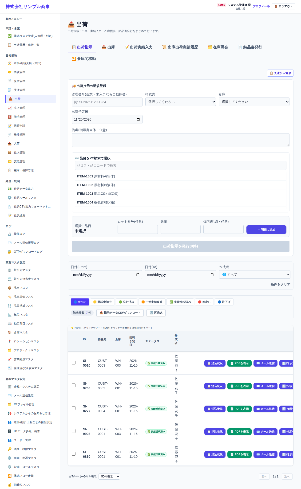
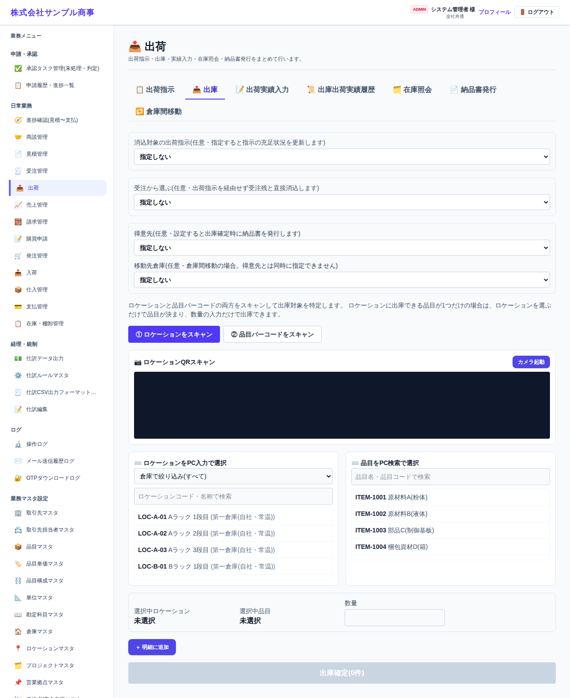
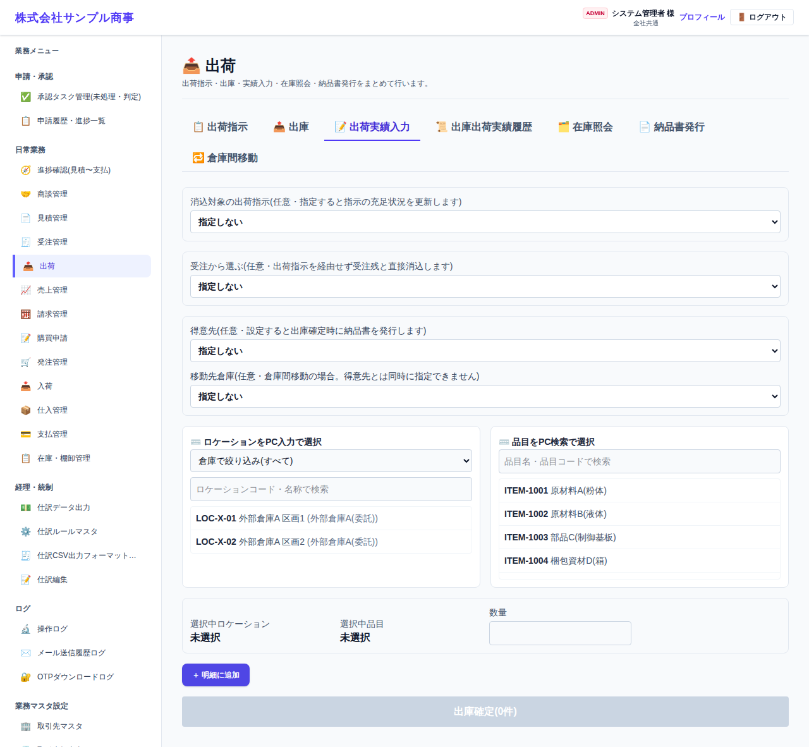
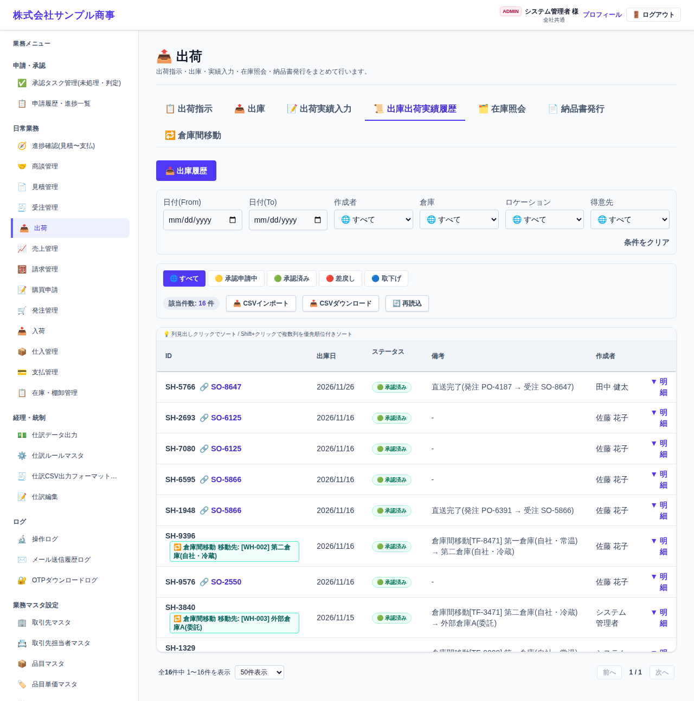
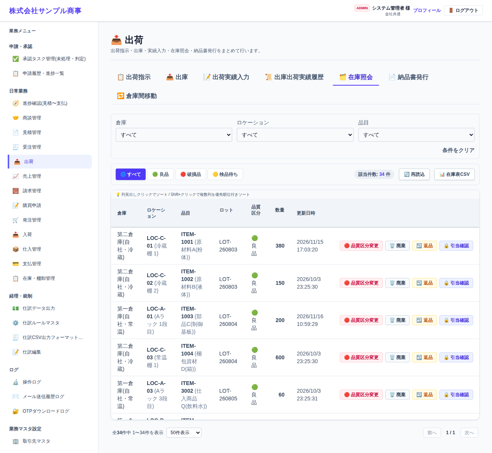
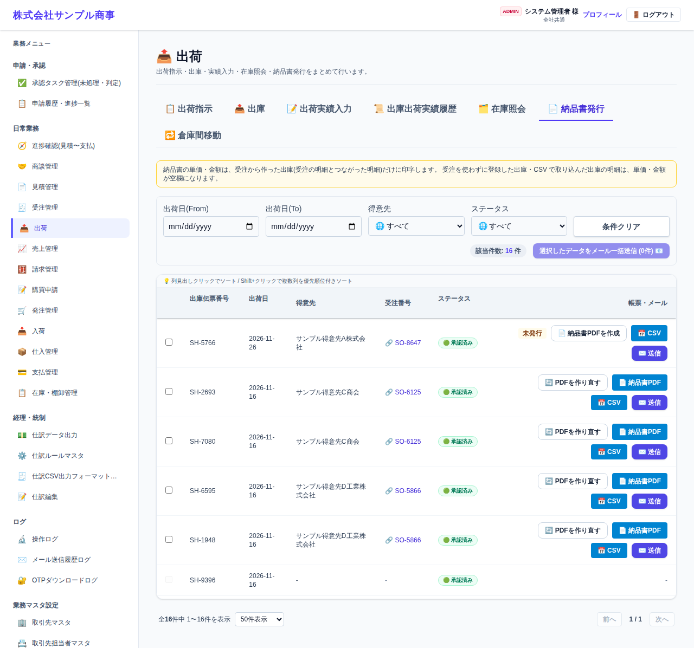

# 出荷

[マニュアルの一覧](../README.md) > 日常業務 > 出荷

得意先への出荷のために、在庫から出します(出庫)。外部倉庫を使う場合は、出荷指示書を送り、実績を入力します。納品書の発行もここで行います。

- **開き方**: メニューの **日常業務** > **出荷**
- **対象**: 全員
- 一覧・検索・並び替え・CSV・承認の共通の操作は、[共通の操作](../basics/common-operations.md) を参照してください。

画面の上のタブで作業を切り替えます。入荷の画面と同じ作りです([入荷](receiving.md) も参照してください)。

| タブ | 内容 |
|---|---|
| 出荷指示 | 外部倉庫へ、出荷の予定(得意先・品目・数量・予定日)を指示します。**受注から選ぶ** で受注を引き継げます |
| 出庫 | 自社倉庫で、在庫から出します(スマートフォンのスキャン可) |
| 出荷実績入力 | 外部倉庫からの出荷の実績を入力します |
| 出庫出荷実績履歴 | これまでの出庫・出荷の記録。差戻しの修正・再申請もここから行います |
| 在庫照会 | 今の在庫 |
| 納品書発行 | 出庫の記録から、得意先に送る納品書を発行します |
| 倉庫間移動 | 倉庫から別の倉庫へ在庫を移します(下の「倉庫間移動」) |

## 出荷指示

得意先・外部倉庫・出荷予定日を選び、品目・ロット・数量を明細に追加して **出荷指示を発行** します。指示書の PDF を発行した後、**✉️ メール送信** で、倉庫の担当者に出荷指示書のダウンロードの案内を送ります(PDF を発行しただけではメールは送りません)。

## 出庫(自社倉庫)

1. 出す場所(ロケーション)と品目を、スキャンまたはパソコンの一覧で選びます(入庫と同じ操作です)。
2. ロット・品質区分・数量を入れて、明細に追加します。
3. 得意先、または **移動先倉庫**(倉庫間の移動の場合)を選びます。得意先を選ぶと、出庫の確定後に **納品書発行** で納品書を発行できます(納品書は自動では作られません)。
   - 倉庫間の移動は、**倉庫間移動** のタブを使ってください。ここで移動先倉庫を選んだ出庫は、移動先の入庫とつながらず、輸送中の在庫・入庫の漏れを確かめられません。
4. 確定します(承認機能を使う場合は申請になります)。

## 出荷実績入力・履歴・在庫照会・納品書発行

| 出荷実績入力 | 出庫出荷実績履歴 |
|---|---|
|  |  |

| 在庫照会 |
|---|
|  |

- **納品書発行**: 確定した出庫の納品書(PDF)を発行・確認し、得意先にメールで送ります。
  - まだ発行していない出庫には「未発行」と出ます。**📄 納品書PDFを作成** で発行します(PDF はお使いのブラウザで作ります。初回だけ数秒かかります)。
  - 未発行のままメールを送ると、送る前に自動で納品書を発行します。
  - 単価・金額は、受注から作った出庫(受注の明細とつながった明細)だけに印字します。受注を使わずに登録した出庫・CSV で取り込んだ出庫の明細は、
    単価・金額が空欄になります(金額を載せたい場合は、受注から出荷指示・出庫を作ってください)。

## 倉庫間移動

1. **＋ 倉庫間移動を作る** を押し、移動元の倉庫・移動先の倉庫・出庫日を選びます(直送用の倉庫は選べません)。
2. 移動元が自社倉庫の場合は、移動元の在庫(品目・ロケーション・ロット)を押して明細に足し、移動する数量を入れます。
   移動元が外部倉庫の場合は、品目を選んで数量を入れます。
3. **出庫する**(移動元が外部倉庫なら **出荷指示を作る**)を押します。
   - 移動元が自社倉庫: 出庫を作ります(承認機能を使う場合は出庫の申請になります)。出庫が確定すると **輸送中** になります。
   - 移動元が外部倉庫: 出荷指示を作ります。宛先は移動先の倉庫です。**出荷実績入力** で出荷の実績を取り込むと **輸送中** になります。
   - 移動先が外部倉庫: 入荷指示も作ります(送り主は移動元の倉庫)。入荷の画面の **入荷実績入力** で実績を取り込むと入庫済みになります。
4. 移動先が自社倉庫の場合は、[入荷](receiving.md) の画面の **倉庫間移動** から入庫します。

- 状態は **出庫の承認待ち** → **輸送中** → **一部入庫** → **入庫済み**(または **差異で完了**)と進みます。出庫を取り下げると **取消** になります。
- 輸送中の数量は、移動元・移動先どちらの在庫数にも入りません。**在庫照会** の下の「輸送中の在庫」に出ます。
- 倉庫間移動の出庫・入庫は、差し戻されても **修正して再申請** できません。申請を取り下げて、倉庫間移動の画面から作り直してください。
- 指示書の宛先・送り主には、倉庫と同じ番号の取引先(区分「倉庫」)を使います。この取引先は [倉庫マスタ](../master/warehouses.md) に合わせて自動で作られます。

## 補足

- 出庫の履歴・納品書の一覧・参照用のカードには、元の受注の番号が出ます。押すと受注の画面が別タブで開きます。
