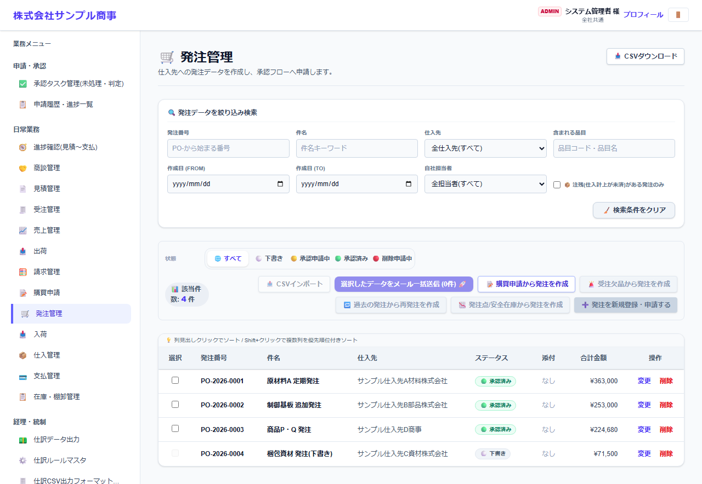
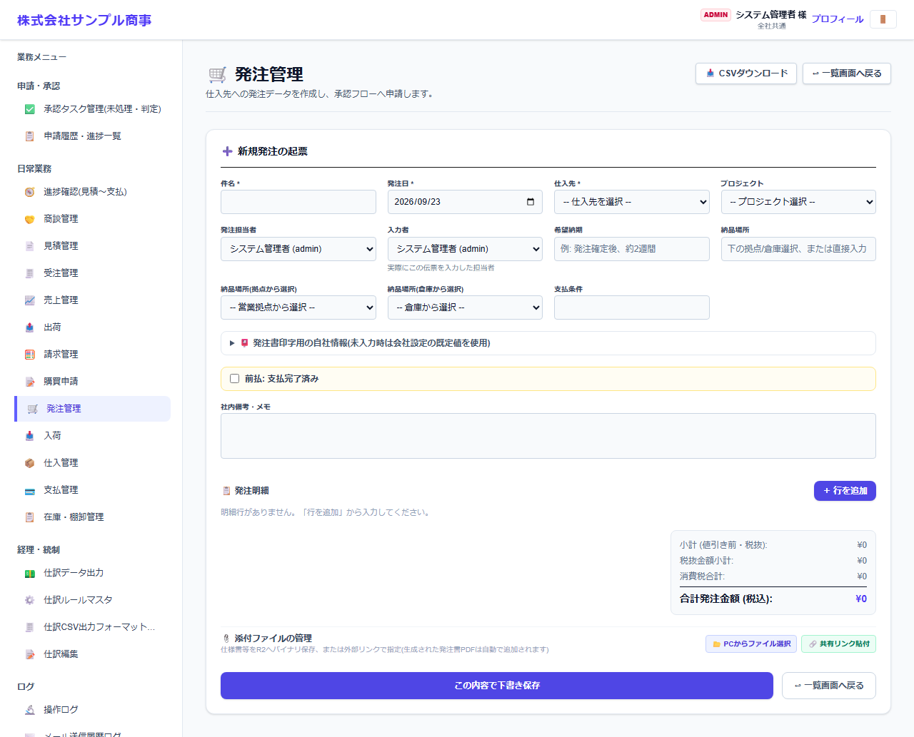

# 発注管理

[マニュアルの一覧](../README.md) > 日常業務 > 発注管理

仕入先への発注を作り、発注書を PDF で出力したり、メールで送ったりします。

- **開き方**: メニューの **日常業務** > **発注管理**
- **対象**: 全員
- 一覧・検索・並び替え・CSV・承認の共通の操作は、[共通の操作](../basics/common-operations.md) を参照してください。

## 一覧

### 一覧の操作

| 操作 | 内容 |
|---|---|
| 状態のタブ | すべて・下書き・承認申請中・承認済み・削除申請中で絞り込みます |
| 絞り込み検索 | 番号・件名・取引先・品目・作成日・自社担当者などで探します |
| 番号を押す | 伝票を開いて、内容の確認・変更・PDF の出力などを行います |
| 複写 | その発注の内容をコピーして、新しい発注の作成画面を開きます([過去の発注を複写して作成する](#過去の発注を複写して作成する)) |
| 左端のチェックボックス + 一括メール送信 | 選んだ伝票の帳票を、取引先の担当者にまとめてメールで送ります(送り先は取引先担当者マスタの「メールで送る帳票」で決まります) |
| CSVインポート / CSVダウンロード | 伝票を一括で取り込む・保存する |

発注の作り方は、ボタンで選べます。

| ボタン | 内容 |
|---|---|
| 購買申請から発注を作成 | 承認済みの購買申請を引き継ぎます |
| 受注欠品から発注を作成 | 在庫が足りない受注から作ります |
| 過去の発注から再発注を作成 | 以前の発注を引き継ぎます |
| 発注点/安全在庫から発注を作成 | 発注点を下回った品目から作ります |
| 発注を新規登録・申請する | 一から作ります |

## 発注を作る

| 項目 | 説明 |
|---|---|
| 件名 *・発注日 *・仕入先 *・プロジェクト | |
| 発注担当者・入力者・発注書印字納期 | 発注書に印字する納期の文言です(明細ごとの希望納期・回答納期とは別の欄です) |
| 納品場所 | 営業拠点・倉庫から選ぶか、自由に入力します(住所が発注書に印字されます) |
| 支払条件 | |
| 発注書印字用の自社情報 | 未入力の場合は、会社・システム設定の値を使います |
| 前払: 支払完了済み | 先に支払う(前払)取引で、支払が済んだら付けます |
| 発注明細 | 品目・数量・単価・税区分・勘定科目・明細ごとの希望納期と回答納期 |
| 添付ファイル | 発注書の控え・仕様書など |

**この内容で下書き保存** で保存します。発注書は、保存した発注を開いて PDF 出力・メール送信します。

- 明細に希望納期・回答納期を入れると、発注書の明細に「納期」の列が出ます(回答納期があれば回答納期、無ければ希望納期を印字します)。
- **受注欠品から発注を作成** で作った場合は、受注の明細の納期が希望納期に入ります。
- 発注書印字納期に日付(`2026-11-10` や `2026/11/10`)を入れると、希望納期が空欄の明細にその日付が入ります(後から追加した行にも入ります)。明細ごとに入れた希望納期は上書きしません。「発注確定後、約2週間」などの文言の場合は入りません。

### 明細の変更・削除について

- 保存済みの明細を変更しても、明細は同じものとして更新されます(入庫・仕入・受注とのつながりは保たれます)。
- 入庫・仕入・明細に付けた添付ファイルに使われている明細は削除できません。削除しようとすると「〇〇から参照されている発注明細は削除できません」と表示されます。

## 過去の発注を複写して作成する

一覧の行の **複写** を押すと、その発注の内容(仕入先・件名・明細・納品場所・支払条件など)が入った作成画面が開きます。必要なところを直して保存すると、新しい番号の発注として登録されます(保存するまでは何も保存されません)。

- 件名の末尾に「(コピー)」が付きます。発注日は今日、状態は下書きになります。入力者は、操作している人になります。
- 番号・承認の状態・購買申請とのつながり・添付ファイル・前払(支払完了済み)・受注明細とのつながり・発注書印字納期・明細の希望納期と回答納期は引き継ぎません。
- 明細の一部だけ・数量を変えて引き継ぎたい場合は、**過去の発注から再発注を作成** を使います。
- **複写** は、登録の権限がある人だけが使えます。承認機能を使っている場合は、発注は購買申請から作るため、**複写** は使えません。

## 希望納期・回答納期を管理する

明細ごとに、こちらが希望する納期(**希望**)と、仕入先から回答された納期(**回答**)を入力します。

### 承認済みの発注の納期を変える(変更申請不要)

承認済みの発注を開くと、明細の下に **📅 納期回答** の欄が出ます。明細の希望納期・回答納期を直して **📅 納期のみ保存(変更申請不要)** を押すと、納期だけが保存されます。

- 承認機能を使っていても、変更申請は不要です。数量・金額などほかの項目の変更は保存されません(ほかの項目は、これまでどおり変更申請で変えます)。
- 承認申請中・削除申請中の発注は、納期も変えられません。
- 新しく追加した行は、先に通常の保存(または変更申請)をしてください。

### 回答納期を受注の納期に反映する

受注(または受注から作った購買申請)とつながっている明細がある場合は、**📅 納期回答** の欄で、保存の時に回答納期を受注の明細の納期に反映するかを選べます。

| 選択 | 受注の明細の納期 |
|---|---|
| 反映しない | 変えません(初期値) |
| 回答納期をそのまま反映 | 回答納期と同じ日 |
| 回答納期に N 日足して反映 | 回答納期の N 日後(土日祝も数える暦日。0〜365日) |

- 反映は、通常の保存・**納期のみ保存**・変更申請の承認確定(承認された時点)のいずれでも行われます。
- 1つの受注明細に複数の発注明細がつながっている場合は、いちばん遅い回答納期を使います。
- 受注が承認済みでも、受注の明細の納期だけが更新されます。結果(何件の受注に反映したか)は保存後のメッセージに出ます。

## CSV の項目(納期・つながり)

CSV には、明細ごとに次の列があります。取り込みの時は、日付を `2026-11-10`(または `2026/11/10`)の形で入れます。存在しない日付があると、1件も取り込まずにエラーになります。

| 列 | 内容 |
|---|---|
| `requestedDeliveryDate` | 明細の希望納期 |
| `answeredDeliveryDate` | 明細の回答納期 |
| `salesOrderItemId` | つながっている受注明細の ID。CSV を出力して取り込み直しても受注とのつながりが保たれます |
| `purchaseRequestItemId` | つながっている購買申請明細の ID |

`salesOrderItemId`・`purchaseRequestItemId` に存在しない ID を入れると、1件も取り込まずにエラーになります。受注の CSV には、明細の納期の列 `itemDeliveryDate` があります。
