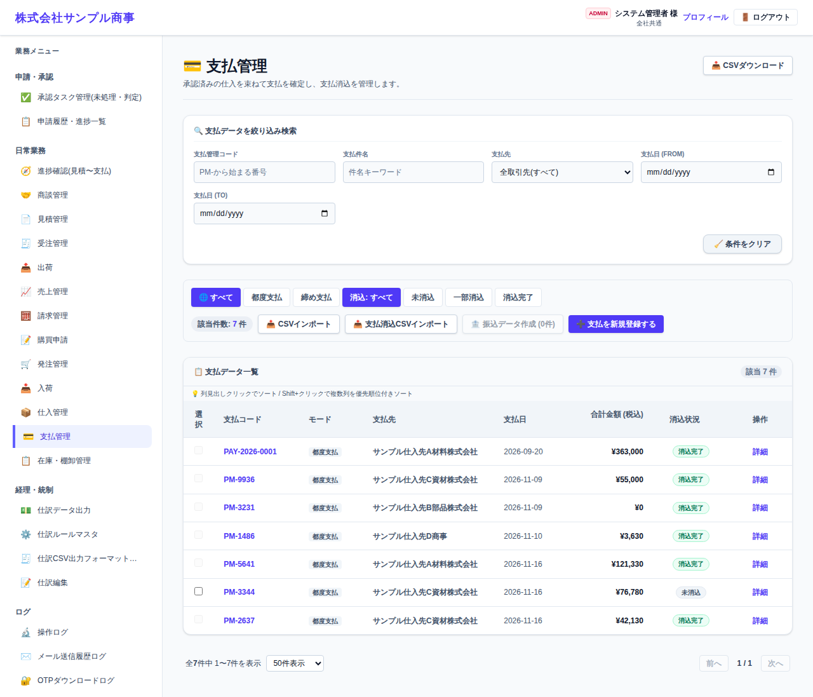
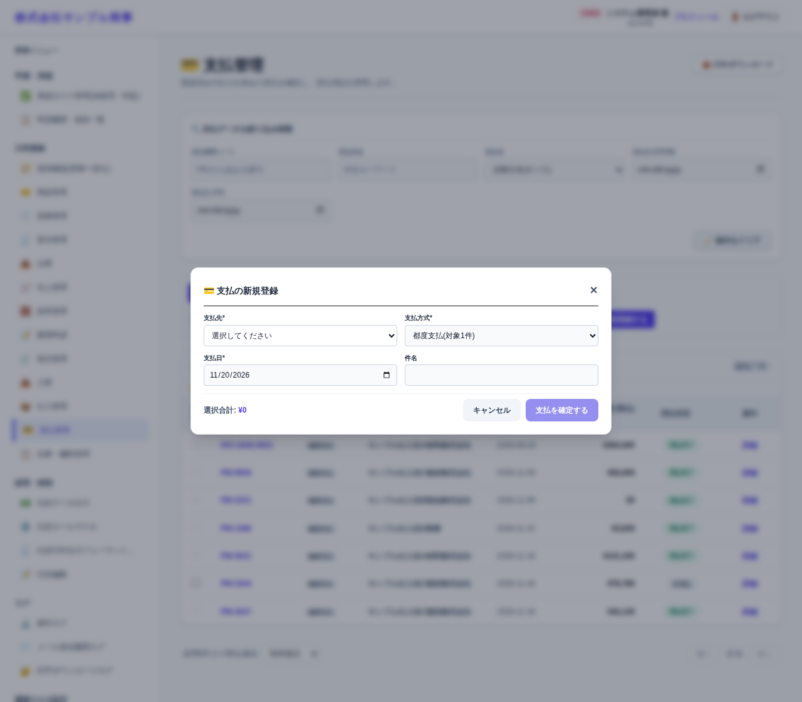

# 支払管理

[マニュアルの一覧](../README.md) > 日常業務 > 支払管理

承認済みの仕入(または検収の記録)をまとめて支払を作り、支払の実績を記録して消し込みます。

- **開き方**: メニューの **日常業務** > **支払管理**
- **対象**: 全員
- 一覧・検索・並び替え・CSV・承認の共通の操作は、[共通の操作](../basics/common-operations.md) を参照してください。

## 一覧

状態のタブで、支払の方式(都度支払・締め支払)や、消込の状況(未消込・一部消込・消込完了)で絞り込みます。
**振込データ作成** で、選んだ支払から全銀形式の振込ファイルを作れます(取引先マスタの振込先口座と、会社・システム設定の振込元の情報を使います)。
**内容を確認する** で件数・合計金額・注意を確かめてから、**ダウンロード** します。会社設定の振込元の口座が未設定・振込先口座が無い・承認前の支払がある、などで確認できない時は、理由が振込データの画面の中に表示されます。

## 支払を作る

**支払を新規登録する** を押すと、支払の作成の画面が開きます。

| 項目 | 説明 |
|---|---|
| 支払先 * | |
| 支払方式 * | **都度支払**(1件ごと)か、**締め支払**(まとめて) |
| 支払日 *・件名 | |

対象の仕入・検収を選んで **支払を確定する** を押します。支払の実績(支払日・金額)は、支払の **詳細** から記録して消し込みます。
支払額が 0 円(相殺・赤伝など)の支払は、**0円で消込を完了する** で消込完了にできます。

### 支払の承認(会社設定で有効にした場合)

[会社設定](../admin/company-settings.md) の承認機能で **支払** を有効にすると、作った支払は **下書き** になり、詳細の **📨 承認を申請する** で申請します。
承認されると、支払の実績を記録でき、総合振込データの対象になります。承認されるまで(承認申請中を含む)は、支払の記録・支払実績の CSV 取込・総合振込データの作成はできません。

- 差し戻し・取り下げられた支払は、下書きに戻ります。
- 承認申請中・承認済みの支払は、支払の CSV 取込で変更できません。
- 承認フローは [承認フロー](../admin/approval-flows.md) で、メニュー **支払管理** に設定します(金額は支払の合計)。支払の消込と承認者を分ける場合は、分岐条件に `documentKind` = `PAYMENT`(支払)・`PAYMENT_DISBURSEMENT`(支払の消込)を指定します。

### 支払の消込の承認(会社設定で有効にした場合)

[会社設定](../admin/company-settings.md) の承認機能で **支払の消込** を有効にすると、記録した支払は **承認待ち** になり、
承認されてから消込額・消込の状態・仕訳に入ります。承認待ちの支払は **承認待ち ¥…** として別に表示し、記録できる金額から引きます。

- 差し戻された支払は **差戻し** として残り、消込額には入りません。直す場合は、もう一度記録して申請します。
- 総合振込データの金額は、承認済みの支払だけを引いた残額です(承認待ちの支払は引きません)。
- 承認機能が有効な間は、支払実績の CSV 取込はできません。
- 承認フローは [承認フロー](../admin/approval-flows.md) で、メニュー **支払管理** に設定します(金額は支払額)。
