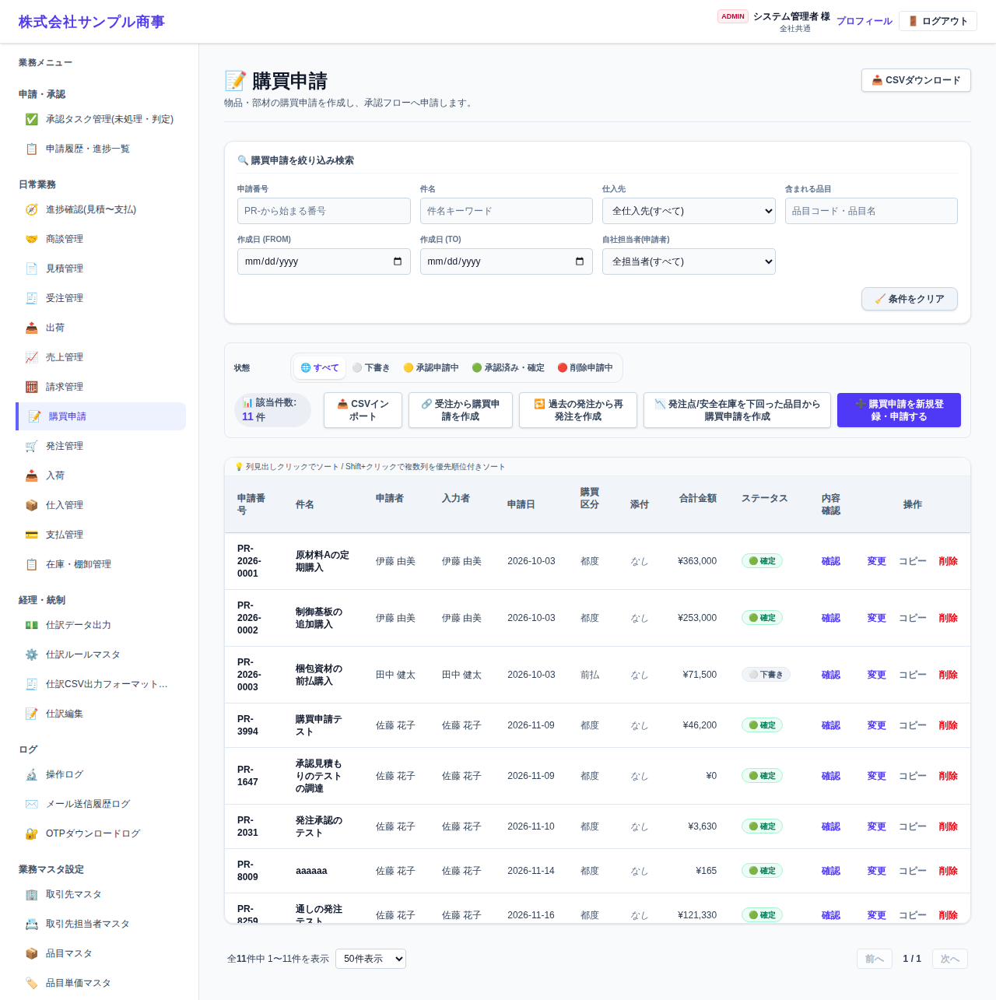
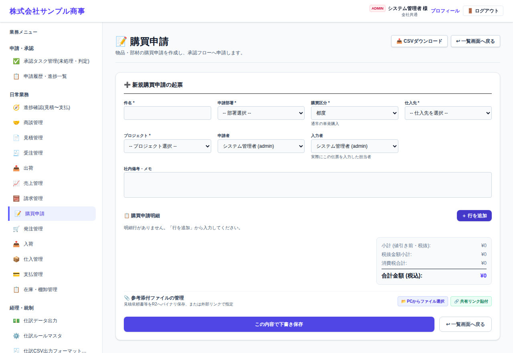

# 購買申請

[マニュアルの一覧](../README.md) > 日常業務 > 購買申請

物品・部材の購入を申請します。承認された購買申請から、発注を作ります。

- **開き方**: メニューの **日常業務** > **購買申請**
- **対象**: 全員
- 一覧・検索・並び替え・CSV・承認の共通の操作は、[共通の操作](../basics/common-operations.md) を参照してください。

## 一覧

| 操作 | 内容 |
|---|---|
| 状態のタブ | すべて・下書き・承認申請中・承認済み・削除申請中 |
| 受注から購買申請を作成 | 受注の明細(欠品の明細だけ、またはすべての明細)から、購買申請を作ります。直送の指定もできます([発注の直送](orders.md#直送)) |
| 過去の発注から再発注を作成 | 以前の発注の内容を引き継いで、購買申請を作ります |
| 発注点/安全在庫を下回った品目から購買申請を作成 | 発注点を下回った品目を提案します(発注点/安全在庫マスタの設定を使います) |
| 内容確認 | **👁️ 内容確認** で、件名・仕入先・明細・添付・合計を右のパネルで確認します(編集画面は開きません) |
| 変更・コピー・削除 | 一覧の右の操作 |

一覧には、申請日(作成した日)・申請者・入力者と、添付のあり・なしも表示されます。

## 購買申請を作る

**購買申請を新規登録・申請する** を押すと、作成の画面になります。

| 項目 | 説明 |
|---|---|
| 件名 *・申請部署 *・購買区分 * | 購買区分は、都度・前払など |
| 仕入先 | 仕入先マスタから選びます(以前に直接入力で保存した申請は、保存する時にマスタから選び直します) |
| プロジェクト *・申請者・入力者 | |
| 直送 | 受注から作った申請で直送を指定した場合だけ出ます。この申請から発注を作る時に、直送の指定と受注の得意先・納品先を引き継ぎます(印を外すと直送ではなくなります) |
| 購買申請明細 | **+ 行を追加** で、品目・数量・見積単価・希望納期などを入力します |
| 参考添付ファイル | 仕入先の見積書など |

**この内容で下書き保存** で保存します。保存すると確認の画面が出て、内容確認・このまま承認を申請する(承認機能を使う場合)・編集を続ける・一覧へ戻るを選べます。
承認機能を使わない場合は、**✅ このまま確定する** で申請を確定します(承認済みになり、発注を作れます)。
申請部署の初期値は、申請者(ログインしているユーザー)の所属部署です。
