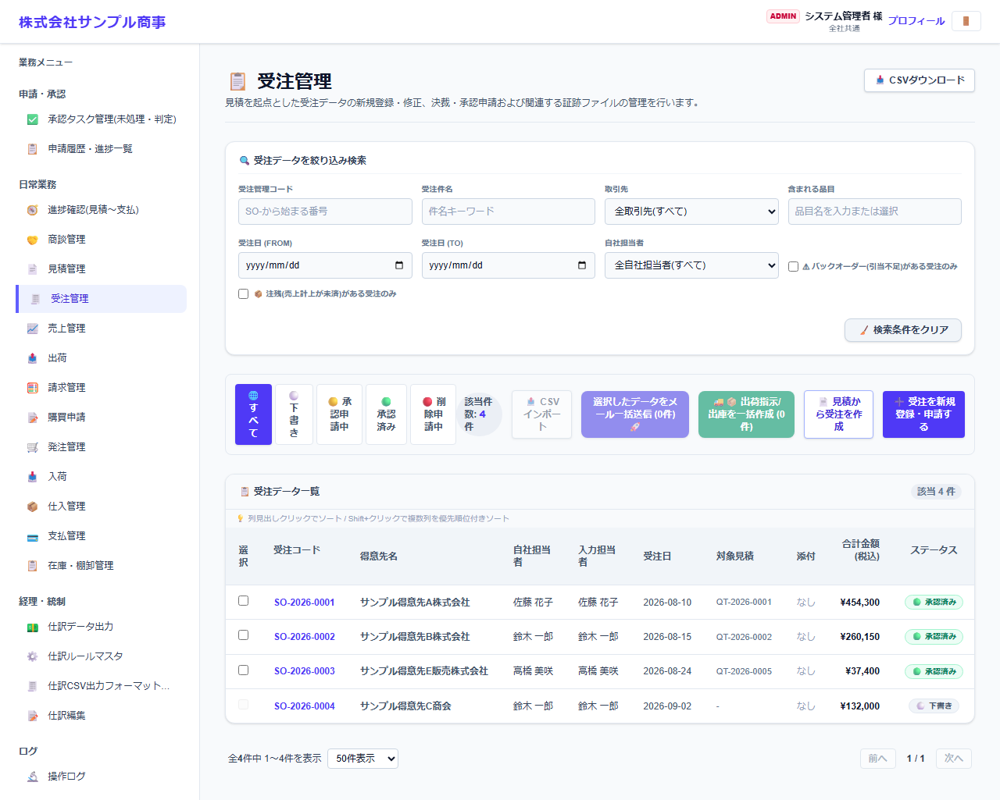
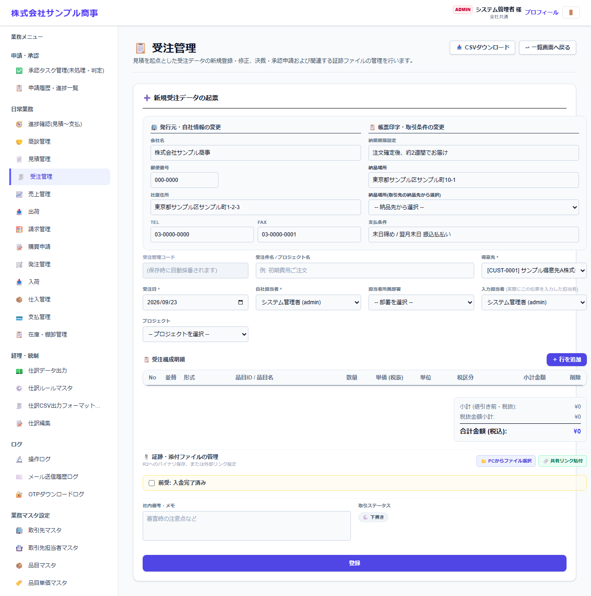

# 受注管理

[マニュアルの一覧](../README.md) > 日常業務 > 受注管理

得意先からの注文(受注)を登録します。承認されると、在庫を引き当てます。注文請書の PDF 出力・メール送信もここで行います。

- **開き方**: メニューの **日常業務** > **受注管理**
- **対象**: 全員
- 一覧・検索・並び替え・CSV・承認の共通の操作は、[共通の操作](../basics/common-operations.md) を参照してください。

## 一覧

### 一覧の操作

| 操作 | 内容 |
|---|---|
| 状態のタブ | すべて・下書き・承認申請中・承認済み・削除申請中で絞り込みます |
| 絞り込み検索 | 番号・件名・取引先・品目・作成日・自社担当者などで探します |
| 番号を押す | 伝票を開いて、内容の確認・変更・PDF の出力などを行います |
| 複写 | その受注の内容をコピーして、新しい受注の登録画面を開きます([過去の受注を複写して登録する](#過去の受注を複写して登録する)) |
| 左端のチェックボックス + 一括メール送信 | 選んだ伝票の帳票を、取引先の担当者にまとめてメールで送ります(送り先は取引先担当者マスタの「メールで送る帳票」で決まります) |
| CSVインポート / CSVダウンロード | 伝票を一括で取り込む・保存する |

- **バックオーダー(引当不足)がある受注のみ**: 在庫が足りずに引き当てられなかった受注だけを表示します。
- **出荷(売上計上)が未完了の受注のみ**: まだ全部を売上にしていない受注だけを表示します。
- **見積から受注を作成**: 承認済みの見積を選んで、内容を受注に引き継ぎます。
- **過去の受注から作成**: 承認済みの受注を選んで、その内容をコピーした登録画面を開きます(行の **複写** と同じです)。

## 受注を登録する

**受注を新規登録・申請する** を押すと、登録の画面になります。

見積とほぼ同じ項目です。受注ならではの項目は次のとおりです。

| 項目 | 説明 |
|---|---|
| 受注日 * | |
| 納品場所(取引先の納品先から選択) | 取引先マスタで登録した納品先から選べます(住所が注文請書・納品書に印字されます)。自由に入力もできます |
| 前受: 入金完了済み | 先に入金を受ける(前受)取引で、入金が済んだら付けます |
| 明細の倉庫の指定 | 明細ごとに、どの倉庫から出すか(倉庫 × 数量)を指定できます。指定しない場合は自動で割り当てます |
| 明細の納期 | 明細ごとの納期(日付)。在庫が無く、仕入先の回答を待って納期を回答する場合などに使います。発注の回答納期から反映することもできます([発注の回答納期を受注の納期に反映する](#発注の回答納期を受注の納期に反映する)) |

- 帳票印字・取引条件の「納期」(「注文確定後、約2週間でお届け」などの文言)は、これまでどおり注文請書に印字する文言です。明細の納期とは別に入力します。
- 明細の納期を入れると、注文請書の明細に「納期」の列が出ます。

### 明細の変更・削除について

- 保存済みの明細を変更しても、明細は同じものとして更新されます(発注・出荷指示・出庫・売上とのつながりは保たれます)。
- 発注・購買申請・出荷指示・出庫・売上に使われている明細は削除できません。削除しようとすると「〇〇から参照されている受注明細は削除できません」と表示されます。数量などを変えて対応してください。
- 承認機能を使っている場合、承認済みの受注の明細の納期を画面で変えるには、ほかの項目と同じく変更申請が必要です(納期の変更はお客様への影響が大きいため)。

## 過去の受注を複写して登録する

一覧の行の **複写** を押すと、その受注の内容(得意先・件名・明細・取引条件など)が入った登録画面が開きます。必要なところを直して保存すると、新しい番号の受注として登録されます(保存するまでは何も保存されません)。

- 件名の末尾に「(コピー)」が付きます。受注日は今日、状態は下書きになります。入力担当者は、操作している人になります。
- 番号・承認の状態・添付ファイル・前受(入金完了済み)・元の見積とのつながり・明細の倉庫の指定・明細の納期は引き継ぎません。
- 一覧の上の **過去の受注から作成** からも同じように複写できます。承認済みの受注を件名で探して選ぶと、丸ごとコピーした登録画面が開きます。
- **複写**・**過去の受注から作成** は、登録の権限がある人だけが使えます。

## 発注の回答納期を受注の納期に反映する

受注の欠品から作った発注(購買申請を経由した場合も含みます)は、仕入先から回答された納期(回答納期)を、受注の明細の納期に反映できます。操作は **発注管理** の画面で行います([発注の希望納期・回答納期](../purchase/orders.md#希望納期回答納期を管理する))。

- 回答納期そのまま、または回答納期に何日か足した日を、受注の明細の納期にします。
- 1つの受注明細を複数の発注に分けて手配している場合は、いちばん遅い回答納期を使います。
- 受注が承認済みでも、受注の明細の納期だけが更新されます(変更申請は不要です)。受注の履歴に「発注(番号)の回答納期から明細の納期を反映」と記録されます。

## 在庫の引当と出荷

- 受注が承認されると、在庫を引き当てます。足りない分はバックオーダーになります(承認は止めません)。
- 出荷は **出荷** の画面で、受注から出荷指示・出庫を作ります。出荷が済んだら、**売上管理** で売上にします。
- 在庫が足りない品目は、**購買申請** の **受注の欠品から購買申請を作成** で仕入の手配ができます。
